**Hey there, I'm Rodrigo** 👋

Follow me on Twitter [@mathsppblog][twitter] for 🐍 Python, 🧠 maths, and 💻 programming content.

## A little bit about myself

- 🔭 I’m currently working on my personal project: [mathspp.com](https://mathspp.com)
- 💬 Ask me about mathematics, programming and bad jokes.
- 📫 You can find my contacts [here](https://mathspp.com/contact-me).
- 😄 Pronouns: he/him/his

## 📖 My most recent articles

<!-- BLOG-POST-LIST:START -->
- [Typing improvements in Python 3.15](https://mathspp.com/blog/typing-improvements-in-python-315)
- [TypedDict with extra items](https://mathspp.com/blog/typeddict-with-extra-items)
- [Module profiling overview](https://mathspp.com/blog/module-profiling-overview)
- [Tachyon: sampling profiling in Python](https://mathspp.com/blog/tachyon-sampling-profiling-in-python)
- [DX improvements in Python 3.15](https://mathspp.com/blog/dx-improvements-in-python-315)
- [Startup configuration files](https://mathspp.com/blog/startup-configuration-files)
- [Unpacking inside comprehensions](https://mathspp.com/blog/unpacking-inside-comprehensions)
<!-- BLOG-POST-LIST:END -->

##  My GitHub activity stats

<!-- Thanks to ofek! -->

[twitter]: https://twitter.com/mathsppblog
